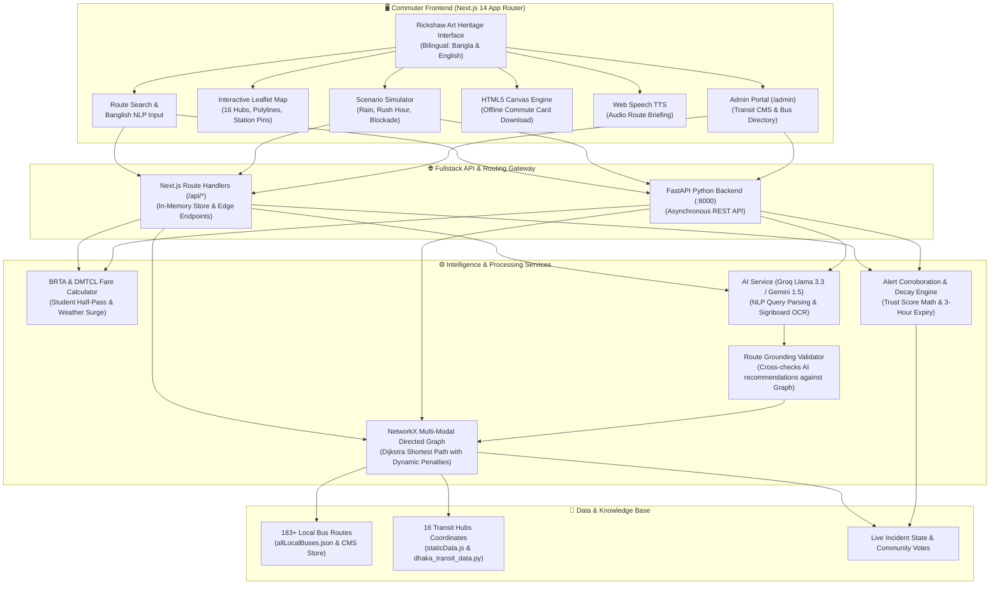

# 🛺 DhakaPath (ঢাকার পথ)
### Live Urban Transit Intelligence & Commute Resilience Engine for Dhaka City
> **Official Hackathon Submission — IAIT National IT Fest 2026 (INIF 2026)**  
> **Track:** Smart City & Intelligent Urban Mobility | **Open-Source Tech Stack**

---

## 🏆 Team Information: Gray Metrics

| Role / Contribution | Member Name | GitHub / Contact |
|:---|:---|:---|
| **Team Lead & Frontend Architect** | **Sabrina Maimon Mihiya** | [@sabrinamaimon](https://github.com/sabrinamaimon) |
| **Backend & Graph Routing Engineer** | **Shifat Reza shoumic** | Team Gray Metrics |
| **UI/UX Designer & Heritage Lead** | **Sadia Binte Alam** | Team Gray Metrics |

---

## 📌 Executive Summary

Standard global navigation platforms (such as Google Maps) systematically fail in Dhaka because they are built around private vehicles and predictable schedules. Commuters in Dhaka rely on an informal, multi-modal ecosystem comprising **over 180+ local bus routes, the MRT-6 Metro Rail, legunas (human haulers), and connector rickshaws**. Daily travel is heavily impacted by **monsoon waterlogging (জলজট), student half-fare rules, sudden intersection blockades, and unregulated weather surges**.

**DhakaPath (ঢাকার পথ)** is an end-to-end, multi-modal transit intelligence and real-time street resilience platform engineered specifically for Dhaka’s geography and commuter realities. Featuring an authentic **Rickshaw Art Heritage UI**, a high-performance **NetworkX Directed Graph Routing Engine**, dynamic **student half-pass fare calculation**, a **Transit CMS & Admin Portal**, **crowdsourced verified alerts with mathematical time decay**, and **offline visual commute cards**, DhakaPath makes navigating Dhaka predictable, equitable, and accessible for everyone.

---

## 🚀 Key Features & Hackathon Capabilities

### 1. Multi-Modal Transit Graph & Route Directory (CMS)
- **16 Major Dhaka Hubs Monitored:** Motijheel, Banasree, Malibagh, Shahbagh, Farmgate, Science Lab, Dhanmondi, Mohammadpur, Mirpur 10, Agargaon, Mohakhali, Badda, Uttara, Jatrabari, Gulshan, and Airport.
- **183+ Verified City Bus Routes & DMTCL MRT-6 Metro Rail:** Includes full stop sequences, operating hours, ticket price ceilings, and vehicle types (AC, Sitting, Semi-Sitting, BRTC Government).
- **Transit CMS & Admin Portal (`/admin`):** Dedicated administrative interface to add, modify, or delete bus routes, tune fare parameters, and monitor live fleet health.

### 2. Intelligent Multi-Constraint Trip Routing
- **NetworkX Directed Graph Engine:** Multi-modal graph with weighted edges accounting for distance, vehicle speed, transfer friction, and real-time incident penalties.
- **Natural Language & Banglish Search:** Search using conversational everyday Banglish (e.g., *"Farmgate theke Motijheel jabo half pass e, Shahbagh avoid kore"*).
- **Multi-Leg Transfers & Landmark Guidance:** Combines rickshaw + metro + bus transfers with physical landmark boarding cues (e.g., *"Board Bikolpo Bus opposite Ananda Cinema Hall; Metro Exit A"*).

### 3. Dynamic Fare Engine & Student Concessions
- **Student Half-Pass Compliance:** Automatic 50% discount on local buses adhering to the statutory **10 BDT minimum bus fare floor**.
- **MRT-6 Metro Rail Matrix:** Fixed distance-based DMTCL government fare matrix (20 to 100 BDT).
- **Weather & Rush Hour Surges:** Rickshaws and CNGs dynamically compute weather multipliers (+50% during rain, +80% monsoon flood) and rush-hour peak surcharges (+25%).

### 4. Live Crowdsourced Street Alerts & Trust Decay Engine
- **Incident Categorization:** Waterlogging, gridlock, VIP movement, protests, and road construction.
- **Trust Score & Corroboration:** Upvote ("Confirm") and Downvote ("Resolved") peer voting with official traffic police verification tags.
- **Mathematical Time-Decay Algorithm:** Alerts progressively decay in confidence over time, automatically archiving after 3 hours to prevent ghost jams.

### 5. Interactive Urban Disruption Simulator
- **Live What-If Stress Testing:** Real-time switches to simulate:
  - 🌧️ **Malibagh Waterlogging (জলজট):** Stalls surface buses; dynamically redirects traffic to elevated metro and amphibious rickshaw corridors.
  - ⏰ **5:30 PM Office Rush Hour:** Doubles travel times on primary arteries (Farmgate, Shahbagh) and activates peak surcharges.
  - 🚫 **Shahbagh Intersection Blockade:** Completely shuts surface road segments; re-routes commuters via peripheral connectors.

### 6. Inclusive Heritage & Accessibility Features
- **Rickshaw Art Typography & Aesthetic:** Vibrant, hand-painted Dhaka rickshaw motif palette (`#b83a2e`, `#f6d16f`, `#15453b`) with native bilingual support (Bangla & English) and persistent Dark/Light modes.
- **Offline Commute Card Generator:** Client-side HTML5 Canvas pass generation for commuters with low battery or zero cellular data.
- **Voice Briefing (TTS):** Browser Web Speech synthesis in Bangla and English for hands-free listening.
- **Signboard & Notice Digitizer (AI OCR):** Camera upload to extract routes and fare tables from physical bus signboards.
- **Commuter Ride-Share Board:** Community board for ride-sharing rickshaws/CNGs with automated split-fare calculations.

---

## 🏗️ System Architecture



---

## 💻 Full Tech Stack

### Frontend Application
- **Framework:** [Next.js 14.2.5](https://nextjs.org/) (React 18, App Router Architecture)
- **Styling:** [Tailwind CSS 3.4](https://tailwindcss.com/), PostCSS, Autoprefixer
- **Typography:** Custom Google Fonts (`Galada` for Rickshaw Art, `Anek Bangla`, `Cinzel Decorative`, `Space Grotesk`)
- **Map & Geospatial:** [Leaflet 1.9.4](https://leafletjs.com/) & [React-Leaflet 4.2.1](https://react-leaflet.js.org/) (OpenStreetMap vector tiles)
- **Icons:** [Lucide React](https://lucide.dev/) (Ultra-clean SVG icon set)
- **Offline Rendering:** Native HTML5 Canvas API (custom graphics and font stamping for PNG commute cards)
- **Speech Synthesis:** Native Browser Web Speech API (`SpeechSynthesisUtterance` for Bangla & English audio briefings)

### Backend & Graph Engine
- **Framework:** [FastAPI 0.110+](https://fastapi.tiangolo.com/) (High-performance asynchronous Python web framework)
- **ASGI Server:** [Uvicorn 0.28+](https://www.uvicorn.org/) with standard uvloop workers
- **Graph Algorithms:** [NetworkX 3.2+](https://networkx.org/) (Directed weighted multi-graph with Dijkstra shortest-path solver)
- **Data Modeling & Validation:** [Pydantic v2](https://docs.pydantic.dev/)
- **AI & NLP:** Groq SDK (`llama-3.3-70b-versatile`) / Google Generative AI (`gemini-1.5-flash`) for multi-turn conversational commute queries and Vision OCR signboard parsing
- **Environment Management:** `python-dotenv`

### Containerization & Deployment
- **Containerization:** Docker & Docker Compose
- **Web Server / Edge:** Vercel (Frontend edge deployment) / Uvicorn (Backend server)

---

## 📦 Dependencies

### Backend Dependencies (`backend/requirements.txt`)
```text
fastapi>=0.110.0
uvicorn[standard]>=0.28.0
pydantic>=2.6.0
networkx>=3.2.1
google-generativeai>=0.4.1
python-dotenv>=1.0.1
requests>=2.31.0
python-multipart>=0.0.9
```

### Frontend Dependencies (`frontend/package.json`)
```json
{
  "dependencies": {
    "autoprefixer": "^10.6.1",
    "leaflet": "^1.9.4",
    "lucide-react": "^0.359.0",
    "next": "^14.2.5",
    "postcss": "^8.5.30",
    "react": "^18.3.1",
    "react-dom": "^18.3.1",
    "react-leaflet": "^4.2.1",
    "tailwindcss": "^3.4.19"
  }
}
```

---

## ⚙️ Installation & Setup Guide

### System Prerequisites
Ensure the following tools are installed on your machine:
- **Node.js:** `v18.x` or `v20.x` LTS ([Download Node.js](https://nodejs.org/))
- **Python:** `3.10`, `3.11`, or `3.12` ([Download Python](https://www.python.org/))
- **Package Managers:** `npm` (bundled with Node) and `pip` (bundled with Python)
- **Git:** Latest version

---

### Method 1: 1-Click Automated Startup (Bash / Linux / macOS / Git Bash)

From the project root directory, run:
```bash
# Make script executable (first time only)
chmod +x start.sh

# Run 1-click startup
./start.sh
```
This script will:
1. Create a Python virtual environment in `backend/venv` (if not already present).
2. Install all Python dependencies from `backend/requirements.txt`.
3. Launch the FastAPI backend on port `8000`.
4. Install all frontend `node_modules` (if not already present).
5. Launch the Next.js development server on port `3000`.

---

### Method 2: Manual Step-by-Step Installation

#### Step 1: Clone the Repository
```bash
git clone https://github.com/sabrinamaimon/inif-hackathon.git
cd inif-hackathon
```

#### Step 2: Configure Environment Variables
Copy `.env.example` to create your local `.env` file:
```bash
# On Windows PowerShell:
Copy-Item .env.example .env

# On Linux / macOS:
cp .env.example .env
```
*(Optional: Insert your `GROQ_API_KEY` or `GEMINI_API_KEY` in `.env` if testing live AI natural language queries. The core deterministic routing and graph calculation works out-of-the-box without any API keys!)*

---

#### Step 3: Setup & Run Backend (FastAPI)

Open a terminal in the `backend/` folder:

**Windows (PowerShell):**
```powershell
cd backend
python -m venv venv
.\venv\Scripts\Activate.ps1
pip install -r requirements.txt
uvicorn main:app --host 0.0.0.0 --port 8000 --reload
```

**macOS / Linux:**
```bash
cd backend
python3 -m venv venv
source venv/bin/activate
pip install -r requirements.txt
uvicorn main:app --host 0.0.0.0 --port 8000 --reload
```

The backend is now live at:
- **REST API:** `http://localhost:8000`
- **Interactive Swagger Documentation:** `http://localhost:8000/docs`
- **Alternative ReDoc Docs:** `http://localhost:8000/redoc`

---

#### Step 4: Setup & Run Frontend (Next.js)

Open a second terminal in the `frontend/` folder:

```bash
cd frontend
npm install
npm run dev
```

The frontend application is now accessible at:
- **DhakaPath Web App:** `http://localhost:3000`
- **Admin CMS Portal:** `http://localhost:3000/admin`

---

### Method 3: Docker Compose Deployment

If you have Docker and Docker Compose installed:
```bash
docker-compose up --build
```
This builds and starts both the `dhakapath_backend` container (`:8000`) and the `dhakapath_frontend` container (`:3000`) within an isolated network.

---

## 📡 REST API Endpoints Overview

| Method | Endpoint | Description |
|:---|:---|:---|
| `GET` | `/` | API status, health metrics, and platform metadata |
| `GET` | `/health` | Health check endpoint returning active Dhaka transit hubs |
| `GET` | `/api/transit/routes` | Returns all 183+ city buses, metro, and leguna transit lines |
| `GET` | `/api/transit/hubs` | Returns geographical coordinates and metadata for all 16 monitored hubs |
| `POST`| `/api/search/routes` | Computes optimal multi-modal routes (Dijkstra algorithm) with student fare options |
| `POST`| `/api/search/nlp` | Processes Banglish or English natural language queries into grounded routes |
| `GET` | `/api/alerts` | Fetches active live street disruptions and incident reports |
| `POST`| `/api/alerts` | Submits a new commuter community disruption report |
| `POST`| `/api/alerts/vote` | Submits Upvote (confirm) or Downvote (resolved) on an incident |
| `POST`| `/api/simulation/trigger` | Triggers what-if scenarios (rain flood, rush hour, or road blockade) |
| `POST`| `/api/chat` | Commuter AI chatbot route queries and multimodal advice |
| `POST`| `/api/bonus/digitize-signboard` | Vision OCR endpoint for extracting route data from bus signs |
| `GET` | `/api/bonus/rideshare` | Fetches active commuter ride-sharing requests |

---

## 🧪 Verification & Demo Testing Scenarios

1. **Test Standard Commute Search:**
   - Origin: `Mirpur 10`
   - Destination: `Motijheel`
   - Toggle: `🎓 হাফ-পাস (Student Half-Pass)`
   - Observe: Route recommendations showing MRT-6 Metro Rail (31 mins, 100 BDT) vs. Direct Bus (Bikolpo/Shikor, 75 mins, 20 BDT half-fare).
2. **Download Offline Commute Card:**
   - Click `📥 কমিউট কার্ড ডাউনলোড` on any route result card.
   - A rendered PNG commute card with heritage art, fare breakdown, and QR code is immediately downloaded for offline use.
3. **Simulate Rain Waterlogging in Malibagh:**
   - Open `বিপর্যয় সিমুলেটর (Disruption Simulator)` tab.
   - Activate `মালিবাগে ভারী বৃষ্টি ও জলজট (Malibagh Waterlogging)`.
   - Observe: Surface bus travel stalled; system re-routes commuters with elevated metro links and +50% rickshaw surge rate.
4. **Access Admin Portal (`/admin`):**
   - Click the `অ্যাডমিন (Admin)` shield icon in the top navbar or visit `/admin`.
   - Search through the 183+ verified local bus directory, inspect bus stop sequences, or test adding a custom transit route.

---

## 👥 Hackathon Team & Acknowledgements

**DhakaPath** was designed and engineered with pride by **Team Gray Metrics** for the **INIF 2026 Smart City Hackathon**:
- **Sabrina Maimon Mihiya** — Lead Frontend Architect & Integration Engineer
- **Shifat Reza shoumic** — Backend, Database & Graph Routing Engineer
- **Sadia Binte Alam** — UI/UX Designer & Rickshaw Heritage Visual Lead

Special thanks to the OpenStreetMap contributors, the Bangladesh Road Transport Authority (BRTA) official fare gazette publications, and Dhaka Mass Transit Company Limited (DMTCL) for foundational transit data.

---

## 📜 License
DhakaPath is open-source software released under the **MIT License**.
